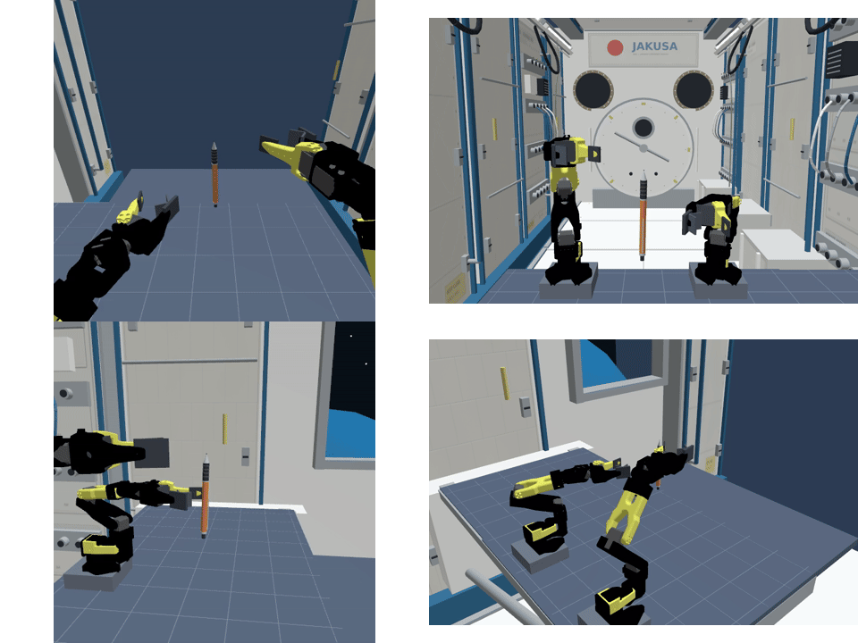

# ISSRobotArmSim

ISS船内をイメージしたGazebo環境で、SO-101 × 2の双腕ロボットを動かすシミュレーションです。**1つのSmolVLA（One Policy）で3タスクを実行**します。

- [概要](#概要)
- [セットアップ](#セットアップ)
- [学習データセット](#学習データセット)
- [データ作成（オプション）](#データ作成オプション)
- [学習方法](#学習方法)
- [推論方法](#推論方法)
- [推論結果](#推論結果)

## 概要

| タスク | 初期状態と目標 |
|---|---|
| Task 1：水滴回収 | 右腕でスポンジを把持した状態から、漂う水滴を接触・接着させる |
| Task 2：ペン把持 | 回転しながら漂うペンを、左腕でつかんで保持する |
| Task 3：キャップ装着 | 左腕でペン、右腕でキャップをつかみ、軸を合わせて差し込む |

両腕は作業台の同じ一辺に並び、一人称カメラを両腕の間に配置しています。
入力は一人称・側面・過去の一人称のRGB画像（各256×256）、関節角12値・関節速度12値、英語指示です。
SmolVLAが左右12軸の絶対関節目標を50ステップ分出力し、先頭10ステップを使ってから再推論します。
目標をROS 2標準のJointTrajectoryControllerへ渡し、シミュレーション時間で10Hzで制御します。新規VLA推論は1Hzです。

| 公開場所 | 内容 |
|---|---|
| このGitHubリポジトリ | コード、ROS設定、アセット、最終モデルと追加学習の初期アダプター（各約21MB） |
| [oxygen65/ISSRobotArm](https://huggingface.co/datasets/oxygen65/ISSRobotArm) | 学習150・検証30エピソード、11,079時刻分、約2.23GBのtar |
| 学習元リポジトリ | 基盤モデル・プロセッサ。セットアップ時に固定revisionから取得 |

## セットアップ

Ubuntu 24.04（WSL 2 + WSLg）、ROS 2 Jazzy、Gazebo Harmonic、Python 3.12、CUDA対応NVIDIA GPUを使用します。

```bash
git clone https://github.com/oxygen0605/ISSRobotArmSim.git
cd ISSRobotArmSim
sudo bash scripts/install_ros_jazzy.sh
bash scripts/setup_runtime.sh
source scripts/ros_env.sh
```

**配布モデルでシミュレーションを動かすだけなら、データセットの取得・学習は不要です。**

## 学習データセット

```bash
source scripts/ros_env.sh
python scripts/download_dataset.py
```

[config/dataset_source.json](config/dataset_source.json)で固定した公開revisionから取得し、tarと展開後ファイルのSHA-256を検証します。保存先は`datasets/rgb_only_balanced50_public/`です。ログインなしで取得できます。

| 分割 | 水滴回収 | ペン把持 | キャップ装着 | 合計 |
|---|---:|---:|---:|---:|
| 学習エピソード | 50 | 50 | 50 | 150 |
| 学習フレーム | 909 | 2,223 | 6,154 | 9,286 |
| 検証エピソード | 10 | 10 | 10 | 30 |
| 検証フレーム | 182 | 455 | 1,156 | 1,793 |

データはエピソードごとのPNG画像とJSONで保存しています。3枚のRGB画像、関節状態、言語指示、教師の関節目標を収録しています。`goal`と`teacher_phase`には、教師ラベルとして目標と動作段階を記録しています。

## データ作成（オプション）

公開データを使う場合は省略できます。教師制御はGazeboの物体位置・向きの真値を使って目標を決め、逆運動学で関節指令に変換します。実際に動かしたRGBと状態・指令を保存し、成功した軌跡を学習に採用します。

```bash
source scripts/ros_env.sh
mkdir -p datasets/my_rgb_data
cp config/rgb_collection_plan.json datasets/my_rgb_data/collection_plan.json
for TASK in task1 task2 task3; do
  ROS_DOMAIN_ID=90 python collect_rgb_dataset.py \
    --output datasets/my_rgb_data --task "$TASK" \
    --train-target 50 --validation-target 10 \
    --train-seed 8100000 --validation-seed 8200000
done

python prepare_rgb_dataset.py \
  --source datasets/my_rgb_data --output datasets/my_rgb_selected
```

学習・検証のseedを分け、物体位置・並進速度・回転方向を変えます。既存フォルダでは完了件数を確認して不足分を収集します。失敗試行は調査用ログとして保存します。

## 学習方法

公開した初期アダプターから、今回と同じ設定で追加学習する例です。

```bash
source scripts/ros_env.sh
bash scripts/train_rgb_chunks30k.sh
```

| パラメータ | 設定 |
|---|---|
| 開始点 | `artifacts/smolvla_rgb_initial` |
| 実効バッチ | 64（micro batch 32 × 累積2回） |
| Optimizer | AdamW、weight decay `1e-4` |
| 学習率 | warmup 1,000、peak `3e-4`、cosine decay、final `3e-5` |
| 更新回数 | 30,000 optimizer step、早期終了なし |
| 保存 | 10,000・20,000・30,000ステップ |
| LoRA | rank 16、alpha 32、dropout 0.05 |
| チャンク／実行 | 50／10 |
| 学習方式 | deterministic endpoint、運動学の補助損失0.003 |

出力は`artifacts/smolvla_rgb_chunks50_steps30000_v1/step_30000/`です。`best`は別途保存する検証最良値で、掲載評価に使ったのは30,000ステップです。

GPUメモリが少ない場合は、実効バッチ64のままmicro batchを小さくできます。再実験では出力先を変えてください。

```bash
RGB_MICRO_BATCH_SIZE=16 \
RGB_OUTPUT_DIR=artifacts/my_rgb_training \
  bash scripts/train_rgb_chunks30k.sh
```

自作データは`RGB_DATASET_DIR=datasets/my_rgb_selected`で指定します。初期重みは本シミュレーションのデータで追加学習したもので、その学習履歴を引き継いで学習を進めます。

## 推論方法

```bash
source scripts/ros_env.sh
ros2 launch iss_capture_ros one_policy.launch.py \
  task:=all seed:=7300002 position_jitter:=true \
  gui:=true record:=true max_steps:=200
```

| 引数 | 意味 |
|---|---|
| `task` | `task1`、`task2`、`task3`、`all` |
| `checkpoint` | 既定は`artifacts/smolvla_rgb_only`（30,000ステップ） |
| `position_jitter` | `true`で評価と同じ各軸±5mmの初期条件を使用 |
| `gui` / `record` | GUI表示／4視点動画の保存 |
| `max_steps` | 制御ステップの上限。評価は200 |

言語指示と配置は[config/task_scenes.json](config/task_scenes.json)にあります。左右はロボット基準です。
結果と等倍速MP4は`runs/one_policy_日時/taskN/`へ保存します。`policy_front.mp4`が一人称、`policy_opposite.mp4`が対面、`policy_side.mp4`が側面、`policy_overview.mp4`が全体です。

別の学習済み重みを使う場合は、`checkpoint:=/絶対パス/step_30000`を指定します。

### 公開データへのオフライン推論

```bash
python infer_dataset.py --episode validation_task1_4200000 --max-frames 10
python infer_dataset.py --episode validation_task2_4200001 --max-frames 10
python infer_dataset.py --episode validation_task3_4200001 --max-frames 10
```

必要なエピソードだけを取得し、記録されたRGB・エンコーダ・言語に対する予測を確認します。タスクの成功率はGazeboでの実行で測定します。

## 推論結果

学習済みの重みと成功判定を固定し、同じ初期条件10個を各タスクで評価しました。

| タスク | 10,000 step | 20,000 step | **30,000 step** |
|---|---:|---:|---:|
| 水滴回収 | 10/10 | 10/10 | **10/10（100%）** |
| ペン把持 | 7/10 | 8/10 | **8/10（80%）** |
| キャップ装着 | 4/10 | 6/10 | **7/10（70%）** |
| 合計 | 21/30 | 24/30 | **25/30** |

実行エラー・再試行は0件です。各10条件での観測値で、20,000と30,000の差は合計1件です。条件によって成否は入れ替わっています。[評価記録](docs/results/rgb/evaluation-summary.json)

以下は同じ30,000ステップモデルの成功動画です。GIF・MP4ともシミュレーション時間の等倍速です。左上＝一人称、右上＝対面、左下＝側面、右下＝全体。

### Task 1：水滴回収


[一人称MP4](docs/results/rgb/media/task1-front.mp4) / [対面MP4](docs/results/rgb/media/task1-opposite.mp4) / [側面MP4](docs/results/rgb/media/task1-side.mp4) / [全体MP4](docs/results/rgb/media/task1-overview.mp4)

### Task 2：ペン把持



[一人称MP4](docs/results/rgb/media/task2-front.mp4) / [対面MP4](docs/results/rgb/media/task2-opposite.mp4) / [側面MP4](docs/results/rgb/media/task2-side.mp4) / [全体MP4](docs/results/rgb/media/task2-overview.mp4)

### Task 3：キャップ装着


[一人称MP4](docs/results/rgb/media/task3-front.mp4) / [対面MP4](docs/results/rgb/media/task3-opposite.mp4) / [側面MP4](docs/results/rgb/media/task3-side.mp4) / [全体MP4](docs/results/rgb/media/task3-overview.mp4)

水滴は評価時のseed 7300000、ペンとキャップは同じ成功条件（7300001・7300002）で別途撮影した例です。表の成功率は評価用30試行から算出しています。

## ライセンス

自作コード・自作アセットは[Apache License 2.0](LICENSE)です。第三者のコード・ロボットモデル・基盤モデルの条件は[THIRD_PARTY_NOTICES.md](THIRD_PARTY_NOTICES.md)と`licenses/`を参照してください。
独立した教育用シミュレーションです。

## 付録：深度情報を利用した実験

RGB画像に深度情報を加えたモデルも試しました。深度から物体の位置・軸方向を求め、学習した動作目標を逆運動学で関節指令に変換する構成です。

| タスク | 成功数／試行数 | 成功率 |
|---|---:|---:|
| 水滴回収 | 4/4 | 100% |
| ペン把持 | 4/4 | 100% |
| キャップ装着 | 3/4 | 75% |

この構成では24エピソードの追加学習で上記の結果を得ました。基本構成の150エピソードと比べて少ないデータであり、**本実装では、深度情報を利用する方が、RGB画像を基本とする構成よりも容易に高い成功率を得られました。** 位置・向きの推定を幾何処理で補えることが、学習を進めやすくしたと考えられます。

制御構成・学習履歴・評価条件が異なるため、構成全体についての開発上の比較です。透明水滴の深度は理想化したシミュレータ表面を用いました。実装と当時の記録は[depth-useブランチ](https://github.com/oxygen0605/ISSRobotArmSim/tree/depth-use)にあります。
