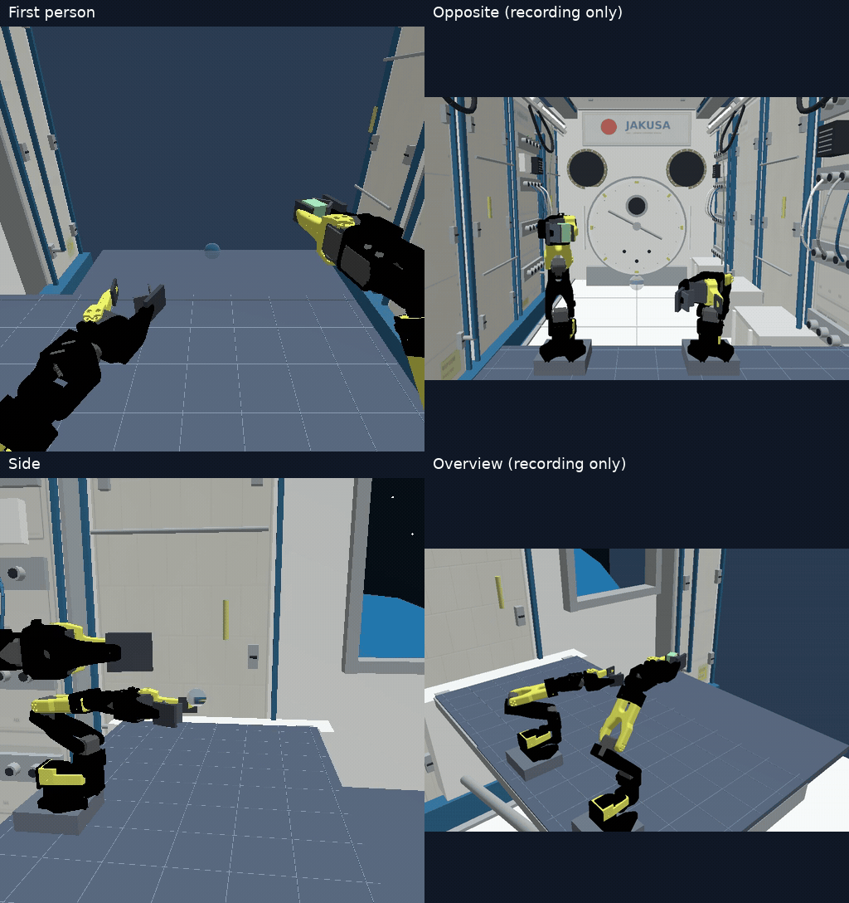
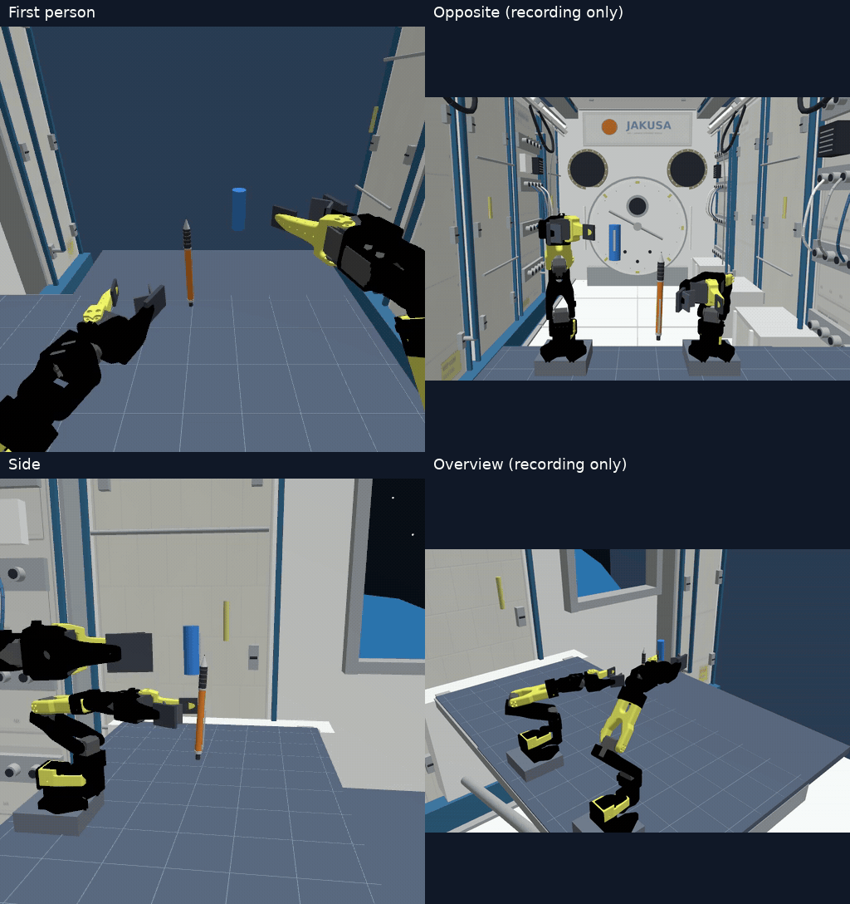

# ISSRobotArmSim

ISS船内をイメージした環境で、SO-101 × 2の双腕ロボットをSmolVLAで動かすシミュレーションです。

- [概要](#概要)
- [セットアップ](#セットアップ)
- [学習データセットの作成（オプション）](#dataset-creation)
- [学習方法](#学習方法)
- [推論方法](#推論方法)
- [推論結果](#推論結果)

## 概要

**1つの学習済みモデルを使うOne Policy構成**で、英語の指示に応じて次の3タスクを実行します。

| タスク | 初期状態と目標 |
|---|---|
| Task 1：水滴回収 | 右腕でスポンジを把持した状態から、両腕の間を漂う水滴に接触させて回収する |
| Task 2：ペン把持 | 両腕の間で回転するペンを、左腕でつかんで保持する |
| Task 3：キャップ装着 | 左腕でペン、右腕でキャップをつかみ、軸を合わせてペン先に差し込む |

両腕は作業台の同じ一辺に並び、一人称カメラを両腕の間に配置しています。
SmolVLAと学習した共有出力部が手先の位置・向き・指の開閉を出力し、逆運動学とROS 2の標準JointTrajectoryControllerで動かします。

入力は一人称・側面・過去の一人称のRGB画像、RGB-Dから推定した幾何情報、関節状態、前回指令、英語指示文です。
物体の真値と接触情報は初期化・教師データ生成・成功判定に用い、推論のモデル入力には渡しません。

| 公開場所 | 内容 |
|---|---|
| このGitHubリポジトリ | コード、ROS設定、アセット、追加学習済み重み（約22.6 MB） |
| [Hugging Face：oxygen65/ISSRobotArm](https://huggingface.co/datasets/oxygen65/ISSRobotArm) | 学習24・検証8エピソード、1,859時刻分の教師データ（約1.81 GB） |
| Hugging Faceの学習元リポジトリ | 基盤モデル・プロセッサ（約912 MB、セットアップ時に取得） |

## セットアップ

動作確認環境はUbuntu 24.04（WSL 2 + WSLg）、ROS 2 Jazzy、Gazebo Harmonic、Python 3.12です。
CUDAを使えるNVIDIA GPUとドライバーが必要です。初回セットアップにはインターネット接続を使います。

~~~bash
git clone https://github.com/oxygen0605/ISSRobotArmSim.git
cd ISSRobotArmSim

# ROS 2・Gazebo・ビルドツールなど
sudo bash scripts/install_ros_jazzy.sh

# Python環境・基盤モデル・水滴プラグイン・ROSパッケージ
bash scripts/setup_runtime.sh
~~~

新しいターミナルでは、リポジトリへ移動して環境を読み込みます。以下のコマンドもリポジトリ直下で実行してください。

~~~bash
cd ISSRobotArmSim
source scripts/ros_env.sh
~~~

**配布済みモデルでシミュレーションを動かすだけなら、データセットの取得や学習は不要です。**
[推論方法](#推論方法)へ進んでください。

## 学習データセットの作成（オプション）

公開済みデータを使う場合は、この節を省略できます。取得コマンドは次のとおりです。

~~~bash
source scripts/ros_env.sh
python scripts/download_dataset.py
~~~

[config/dataset_source.json](config/dataset_source.json)で固定したrevisionから取得し、アーカイブと展開後のファイルのSHA-256を検証します。
保存先は datasets/task_scenes_v1/ です。形式はPNG・NPZ・JSONによる独自形式で、LeRobotDataset形式ではありません。

### 自分で教師データを作成する

教師制御はGazeboから物体の正確な位置・向きを取得し、移動や回転を見積もって手先の目標を決めます。
逆運動学で各関節の角度に変換し、実際にシミュレータを動かしてRGB-D画像と動作指令を記録します。

まず1エピソードだけ作る例です。出力先には新しいフォルダを指定してください。

~~~bash
python collect_task_scene.py   --task task1 --split train --seed 4100000   --output datasets/teacher_preview/train_task1_4100000
~~~

3タスクをまとめて収集する場合は、公開データと別の保存先を指定します。

~~~bash
python collect_task_scene_suite.py   --output-root datasets/generated_task_scenes   --train-count 8 --validation-count 4
~~~

各タスクについて学習8条件・検証4条件を試行します。成功件数は実行結果によって変わります。
学習・検証は別のseed群を使い、初期位置・速度・回転方向を変化させます。
成功軌跡を学習対象にし、未成功の試行も記録します。教師はタスクの実行時には使用しません。

各エピソードには以下を保存します。

- RGB画像：一人称、側面、過去の一人称
- 深度画像：一人称・側面のfloat32配列（NPZ、単位m）
- samples.json：関節状態、指示文、教師指令、時刻など
- result.json：task・split・seed・初期条件・成功判定
- 接触情報、シミュレータ設定、ログなど

## 学習方法

### 公開データで追加学習する

~~~bash
source scripts/ros_env.sh
TRAIN_OUTPUT="$PWD/artifacts/retrained_$(date +%Y%m%d_%H%M%S)"
bash scripts/train_task_scenes.sh "$TRAIN_OUTPUT"
~~~

公開データを取得・検証した後、次の順で学習します。

1. 公開モデルを初期値として、SmolVLAのLoRAなどを1,500ステップ追加学習する。
2. タスク・把持・組み立て段階と目標を扱う共有出力部を12,000ステップ学習する。

新しいモデルは artifacts/retrained_日時/head/best/ に保存されます。
出力先を指定する場合は、スクリプトの第1引数に新規フォルダを渡します。
これは公開モデルからの追加学習手順です。以前のアダプターも引き継いだ元モデルの全学習履歴を、最初から再現する手順ではありません。

### 自分で作成したデータを使う

前節の datasets/generated_task_scenes/ を使う場合の例です。全タスクの学習・検証の成功エピソードが必要です。

~~~bash
TRAIN_OUTPUT="artifacts/generated_$(date +%Y%m%d_%H%M%S)"

python train_scene_backbone.py   --data datasets/generated_task_scenes   --resume-from artifacts/smolvla_one_policy   --output "$TRAIN_OUTPUT/backbone"   --endpoint --steps 1500 --batch-size 6 --lr 0.0001 --eval-every 250

python train_scene_head.py   --dataset datasets/generated_task_scenes   --checkpoint "$TRAIN_OUTPUT/backbone/best"   --output "$TRAIN_OUTPUT/head"   --grip-closure-refinement --assembly-step-refinement --steps 12000
~~~

公開データで学習したモデルには、データセットの参照先・revision・ハッシュも保存します。

## 推論方法

### Gazeboで3タスクを実行する

~~~bash
source scripts/ros_env.sh
ros2 launch iss_capture_ros one_policy.launch.py   task:=all seed:=3300002 gui:=true record:=true
~~~

| 引数 | 指定例 |
|---|---|
| task | all、task1、task2、task3 |
| seed | 初期状態を決める整数。掲載動画は3300002 |
| gui | trueで画面表示、falseでGUIなし |
| record | trueで動画を保存 |
| checkpoint | 使用するモデルのディレクトリ。標準はartifacts/smolvla_one_policy |

追加学習したモデルは、checkpointにhead/best/の絶対パスを指定して実行します。
以下のTRAIN_OUTPUTは学習時に設定した出力先です。別のターミナルでは、そのフォルダを再設定してください。

~~~bash
ros2 launch iss_capture_ros one_policy.launch.py   task:=all seed:=3300002   checkpoint:="$(realpath "$TRAIN_OUTPUT/head/best")"
~~~

物体の初期配置と英語指示文は [config/task_scenes.json](config/task_scenes.json) にあります。
左右はロボット基準です。対面カメラでは画面上の左右が逆になります。

動画と結果は runs/one_policy_日時/taskN/ に保存します。

| ファイル | 内容 |
|---|---|
| policy_front.mp4 | 一人称視点 |
| policy_side.mp4 | 側面視点 |
| policy_overview.mp4 | 俯瞰視点（記録専用） |
| policy_opposite.mp4 | 対面視点（記録専用） |
| policy_front_depth.mp4 / policy_side_depth.mp4 | 深度表示 |
| result.json / trace.json | 成功判定・条件・各ステップの指令など |

### 公開データを使ってオフライン推論する

~~~bash
python infer_dataset.py --episode validation_task1_4200000 --max-frames 10
python infer_dataset.py --episode validation_task2_4200001 --max-frames 10
python infer_dataset.py --episode validation_task3_4200001 --max-frames 10
~~~

必要なエピソードだけを取得し、記録された画像・深度・関節状態から予測します。
出力先は runs/dataset_inference_日時/ です。シミュレータは動かさないため、この結果は閉ループの成功率とは区別します。

## 推論結果

以下は、先にHTMLで掲載したseed 3300002の成功動画です。
配布モデルとアダプター・共有出力部の重みが同じであることをハッシュで確認しています。

**GIFはシミュレーション時間に対して等倍速（10 fps表示）です。**
元の等倍速MP4から作成し、終了後約1秒の保持も含みます。推論待ちを含む実際の処理速度を示すものではありません。
配置は左上＝一人称、右上＝対面、左下＝側面、右下＝俯瞰です。

### Task 1：水滴回収

[一人称MP4](docs/results/media/task1-front.mp4) /
[対面MP4](docs/results/media/task1-opposite.mp4) /
[側面MP4](docs/results/media/task1-side.mp4) /
[俯瞰MP4](docs/results/media/task1-overview.mp4)

### Task 2：回転するペンの把持

[一人称MP4](docs/results/media/task2-front.mp4) /
[対面MP4](docs/results/media/task2-opposite.mp4) /
[側面MP4](docs/results/media/task2-side.mp4) /
[俯瞰MP4](docs/results/media/task2-overview.mp4)

### Task 3：キャップ装着

[一人称MP4](docs/results/media/task3-front.mp4) /
[対面MP4](docs/results/media/task3-opposite.mp4) /
[側面MP4](docs/results/media/task3-side.mp4) /
[俯瞰MP4](docs/results/media/task3-overview.mp4)

### 評価結果

学習・モデル選択に使わなかった4条件ずつの評価結果です。上の成功動画とは別の試行です。

| タスク | 成功数／試行数 | 成功率 |
|---|---:|---:|
| Task 1 | 4／4 | 100% |
| Task 2 | 4／4 | 100% |
| Task 3 | 3／4 | 75% |
| 合計 | 11／12 | 91.7% |

[評価条件・モデルのハッシュ・各試行の結果](docs/results/evaluation-summary.json)

透明水滴の深度には理想化した表面を使い、吸着は接触後に球体表示をスポンジへ追従させています。
吸水・流体計算は行っていません。把持には独自のV溝パッドを使っています。

## ライセンス

自作コード・自作アセットは [Apache License 2.0](LICENSE) です。
第三者のコード、ロボットモデル、学習元モデル等はそれぞれのライセンスに従います。
[THIRD_PARTY_NOTICES.md](THIRD_PARTY_NOTICES.md) と licenses/ を参照してください。

SO-101は使用するURDFと13メッシュに絞り、元のライセンス・出典を添付しています。
本プロジェクトは独立した教育用シミュレーションであり、JAXA等の公式製品ではありません。
